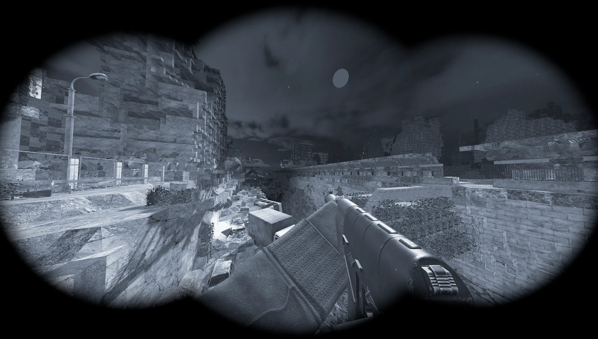
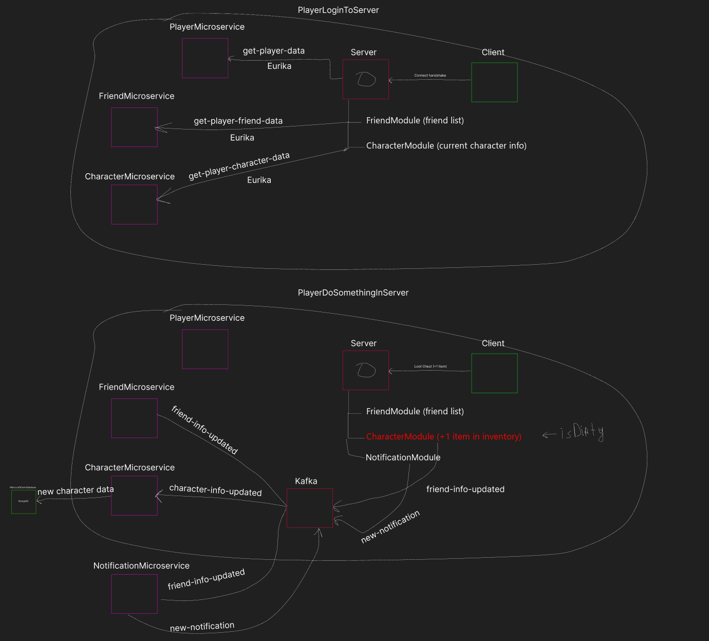
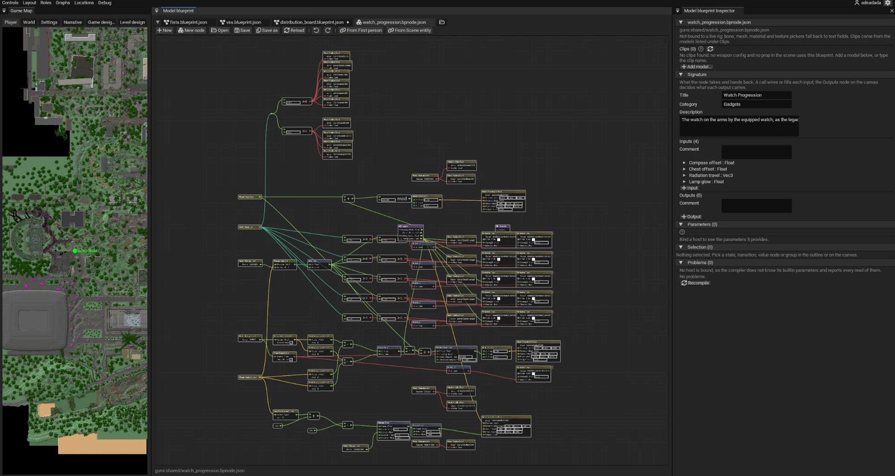
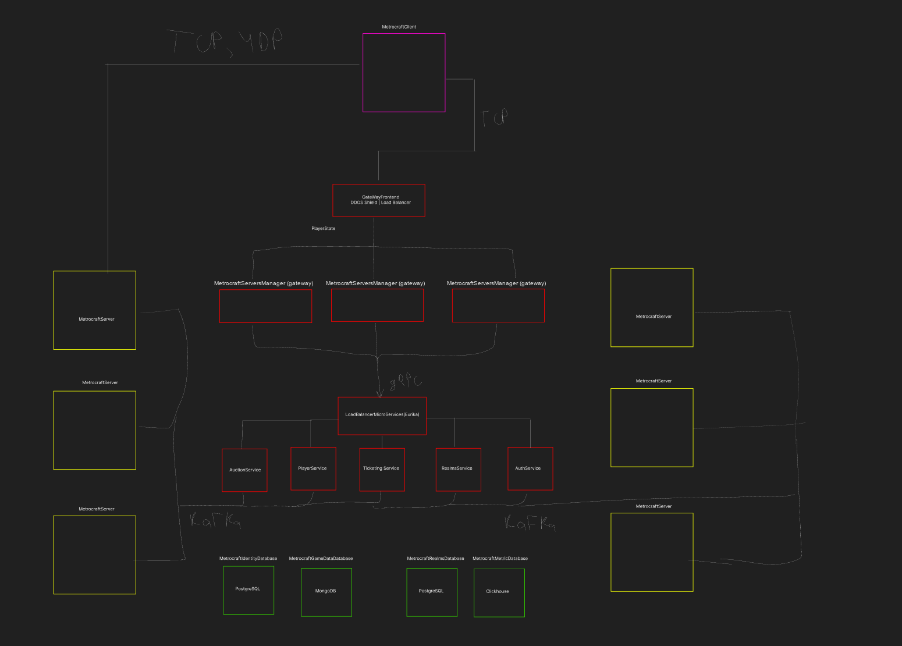
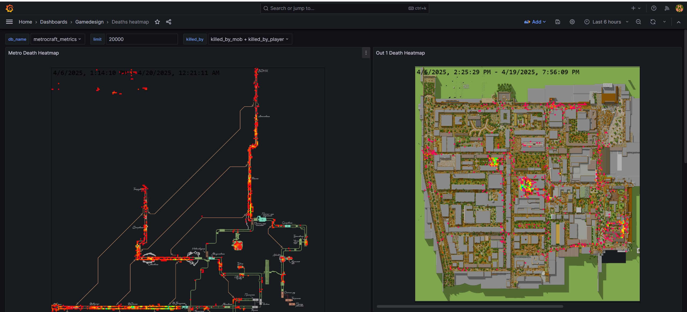
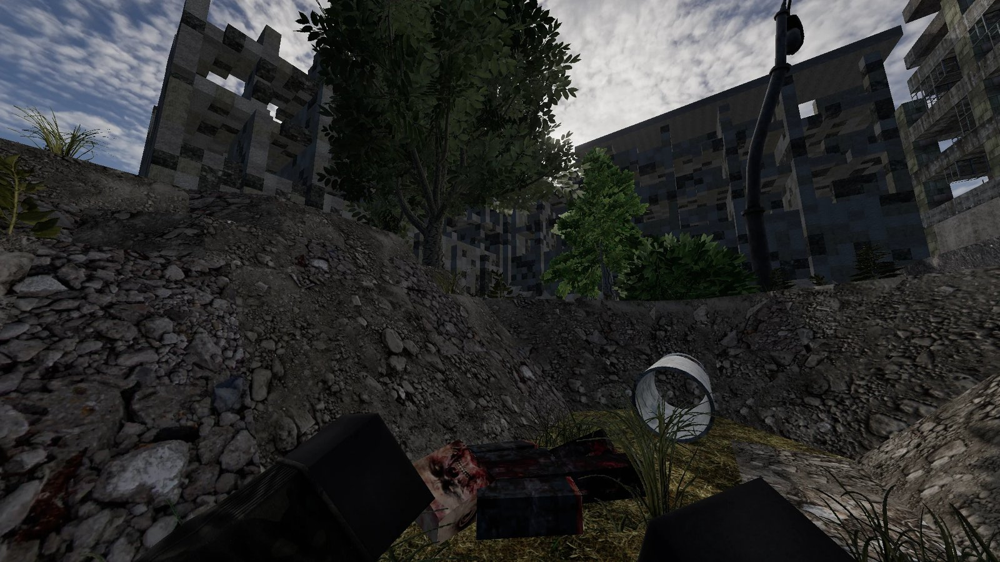

# Metrocraft 2036

Multiplayer online post-apocalyptic game set in the Moscow metro, built on our own game engine written in-house in Java. Client and server, microservices, a website with accounts and payments, a launcher, an admin panel and player support.

[metrocraft36.com](https://metrocraft36.com) · [YouTube channel](https://www.youtube.com/@metrocraft36) · [Discord](https://discord.com/invite/xSgCwrWRVk) · [Website and player services write-up](https://github.com/IgorJs2/MetrocraftSite)

> Source code is private (Interactive Game Studio). This repository describes the project and my role.

## At a glance
| | |
|---|---|
| My role | Project Lead / CTO, Apr 2024 – Sep 2026 |
| Team | 20–40 people: developers, game designers, narrative designers, artists, QA |
| Audience before open beta | 700 pre-registrations · 300 peak concurrent players in tests · 5,000 Discord members |
| Milestones | Closed beta in spring 2025, then preparation for open beta |
| My code | ~2,100 commits, ~2M lines added; author of over half of all server commits |

## Devlogs
Videos recorded by team members in our engine:
- [NavMesh and State Tree](https://www.youtube.com/watch?v=RJjwFcWkD24): rebuilt NPC navigation and AI. Mobs now use navigation meshes and State Tree logic, so NPCs can be as complex as a quest needs.
- [Interactive doors](https://youtu.be/qnzXU3kZo9I)
- [Gameplay footage, July 2026](https://www.youtube.com/watch?v=RTaPYEvFViU)

How a player login and an in-game action flow between the game server, Kafka and the microservices:

## Leading the project
- Ran the backlog and releases in Jira, with separate version lines for the engine and the game, and assigned and accepted work across all disciplines.
- Confluence documentation: design docs for game mechanics, quest-authoring guides for narrative designers, technical docs, patch notes.
- Hiring through the careers page and the admin panel; sourcing and accepting 3D assets from contractors.
- Closed beta operations (whitelists, daily fixes from reports), open beta preparation, Bug Bounty and a media program.

## Engine and gameplay (Java)
- Moved the project from its Minecraft/Forge legacy to our own engine: LWJGL3, PBR rendering with lighting and shadows, NanoVG and then Noesis UI, FMOD audio, Jolt physics, PopcornFX effects.
- Custom UDP networking (RakNet, io_uring): chunk streaming, preloading, texture streaming, network metrics.
- Modular architecture with about 70 modules on each side, a packet registry and a shared client-server config format.
- Gameplay systems: inventory and equipment, trading and barter, perks, clans and faction wars, outposts, weapons and shooting, anti-cheat logs, voice chat.
- World editor for the team: roles and permissions, edit history, prefabs, interactive objects, an NPC and quest editor, visual graphs (State Tree, Event Graph), Google Sheets import and export, and an MCP server that lets Claude drive the editor.

The model blueprint editor, a node graph that drives first-person animation (here, the watch on the player's wrist), next to the game map:

The backend layout: client, gateway, server managers, gRPC microservices behind Eureka, Kafka and the databases:

## Backend and web
- Java/Spring Boot microservices with gRPC, Kafka and Eureka: characters, inventory, quests, factions, realms, anti-cheat.
- Website backend moved from NestJS to seven Java services behind a gateway, with Keycloak SSO (social login, Twitch, Telegram linking).
- Payments: PayPal, YooMoney, Enot, UnitPay.
- Next.js website in two editions (RU and global), a Flarum forum with SSO and an admin panel (players, punishments, mailings, auction).
- Tauri launcher with versioning, 2FA, telemetry and S3/CDN plus peer-to-peer delivery.

A Grafana dashboard with player death heatmaps for the metro and the surface:

## Infrastructure
- Docker Compose for dev, staging and production; GitHub Actions pipelines with obfuscation, asset encryption and automated releases.
- Game-server containers behind a Quilkin proxy, an nginx TCP firewall in front of the microservices.
- PostgreSQL, MongoDB, ClickHouse, Redis, MariaDB; incremental backups to S3; player analytics in ClickHouse.
- Self-hosted studio tooling: Keycloak SSO with one role matrix, Jira, Confluence, Mattermost, GitHub and Bitbucket with Git LFS, Sentry, Prometheus, Grafana, Loki, Wazuh, CrowdSec, Vault, a FreeScout helpdesk linked to Jira, VPN access.

## Tech stack
| Area | Stack |
|---|---|
| Game | Java 21/25, Gradle, LWJGL3, OpenGL, NanoVG, ImGui, Noesis, FMOD, Jolt, PopcornFX, Recast/Detour, Netty, RakNet |
| Services | Spring Boot, gRPC, Protobuf, Kafka, Eureka, Flyway, Maven; Node.js, NestJS, TypeORM |
| Frontend | Next.js, React, TypeScript, Tauri |
| Data | PostgreSQL, MongoDB, ClickHouse, Redis, MariaDB, S3 |
| Infrastructure | Docker, Docker Compose, GitHub Actions, nginx, Caddy, Cloudflare, Portainer, Quilkin, Linux |
| Observability and security | Sentry, Prometheus, Grafana, Loki, Wazuh, CrowdSec, Vault, Keycloak |

## More screenshots

